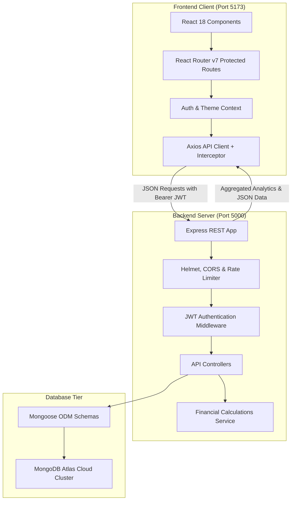

# 💎 FinFlow — Full-Stack MERN Personal Finance & Wealth Platform

<div align="center">


[](https://opensource.org/licenses/MIT)
[](https://nodejs.org/)
[](https://react.dev/)
[](https://www.mongodb.com/atlas)
[](https://tailwindcss.com/)

**An enterprise-grade, luxury-aesthetic personal finance, budget tracking, and wealth architecture platform.**

[Features](#-key-features) • [Tech Stack](#-languages--tools-used) • [Architecture](#-system-architecture) • [Getting Started](#-step-by-step-setup-guide) • [API Reference](#-api-endpoints-reference) • [Security](#-security--privacy-architecture)

</div>

---

## 📖 Overview

**FinFlow** is a modern full-stack web application engineered to transform personal financial management. Combining the power of the **MERN** stack (MongoDB, Express, React, Node.js) with high-velocity **Vite** build tooling, FinFlow delivers executive financial clarity through:

- **Real-Time Cash Flow Velocity**: Dynamic monitoring of inflows, outflows, and net burn rates.
- **Envelope Budgeting**: Real-time spending threshold meters with automated visual health alerts.
- **Categorized Transaction Ledger**: Instant filtering, sorting, pagination, and multi-field search.
- **Savings Goals & Vault Tracking**: Visual milestone progress, target dates, and priority indicators.
- **Dual Luxury Theme System**: Built-in dark mode (deep burgundy charcoal) and warm executive light mode.

---

## 🛠️ Languages & Tools Used

### 🌐 Core Languages
| Technology | Badge | Purpose |
|---|---|---|
| **JavaScript (ES6+)** |  | Primary programming language used across both frontend and backend |
| **HTML5** |  | Semantic structure, accessibility, and modern web layout |
| **CSS3** |  | Design tokens, custom CSS properties, gradients, and scrollbars |

### 🎨 Frontend Ecosystem
| Tool / Library | Badge | Role in Project |
|---|---|---|
| **React 18** |  | Declarative component architecture and interactive state flows |
| **Vite** |  | Ultra-fast HMR (Hot Module Replacement) and optimized production bundler |
| **Tailwind CSS v3** |  | Utility-first responsive styling and theme configuration |
| **Recharts** |  | Interactive data visualizations (Cash flow bars, expense donut breakdown) |
| **Framer Motion** |  | Smooth UI transitions, modal animations, and interactive cards |
| **Lucide Icons** |  | Consistent, modern vector financial and navigation iconography |
| **React Router DOM v7** |  | Client-side routing, route guards (`ProtectedRoute`), and layouts |
| **Axios** |  | Promise-based HTTP client with request/response interceptors |

### ⚙️ Backend & Database
| Tool / Library | Badge | Role in Project |
|---|---|---|
| **Node.js** |  | Asynchronous event-driven server runtime environment |
| **Express.js** |  | RESTful API framework, middleware routing, and request pipelines |
| **MongoDB Atlas** |  | Cloud NoSQL database cluster for scalable distributed storage |
| **Mongoose** |  | Object Data Modeling (ODM) schema definition, validation, and hooks |
| **JWT (jsonwebtoken)** |  | Stateless authentication via signed JSON Web Tokens |
| **Bcrypt.js** |  | Cryptographic password hashing with salted rounds |
| **Helmet** |  | HTTP security headers protecting against common web exploits |
| **Express Rate Limit** |  | API rate limiting safeguarding authentication endpoints from brute-force |

### 🛠️ Developer Tooling & DevOps
| Tool | Badge | Role in Project |
|---|---|---|
| **Concurrently** |  | Orchestrates parallel execution of backend & frontend in 1 terminal |
| **Nodemon** |  | Automatic server restarts upon backend code changes |
| **PostCSS & Autoprefixer**|  | Modern CSS transformation and vendor-prefix generation |
| **Git & GitHub** |  | Distributed version control and remote collaborative repository |

---

## 🏗️ System Architecture



---

## 🚀 Step-by-Step Setup Guide

Follow this comprehensive guide to install, configure, and launch the platform on any machine:

### 1. Prerequisites
Ensure you have the following installed on your computer:
- **Node.js**: v18.0.0 or higher (`node -v`)
- **npm**: v9.0.0 or higher (`npm -v`)
- **Git**: Installed and configured (`git --version`)

---

### 2. Clone the Repository
```bash
git clone https://github.com/maxtris97/Expense-and-budget-magnagment-platform.git
cd Expense-and-budget-magnagment-platform
```

---

### 3. Install All Dependencies (One-Click)
FinFlow uses a monorepo structure. You can install root, server, and client dependencies in one command:

```bash
npm run install:all
```

*(This runs `npm install` in root, `client/`, and `server/` automatically).*

---

### 4. Configure Environment Variables

Create `.env` files in both `server/` and `client/` directories based on the provided examples:

#### A. Backend Config (`server/.env`)
Create `server/.env`:
```env
PORT=5000
NODE_ENV=development
MONGODB_URI=mongodb+srv://<username>:<password>@cluster0.bz03qcs.mongodb.net/finflow?retryWrites=true&w=majority
JWT_SECRET=finflow_super_secret_jwt_key_2026_production_style
JWT_EXPIRES_IN=7d
CLIENT_URL=http://localhost:5173
COOKIE_SECRET=finflow_cookie_signing_secret_98765
```

> **Tip for Local MongoDB:** If running MongoDB locally instead of Atlas, set:
> `MONGODB_URI=mongodb://127.0.0.1:27017/finflow`

#### B. Frontend Config (`client/.env`)
Create `client/.env`:
```env
VITE_API_URL=http://localhost:5000/api
```

---

### 5. Seed Realistic Demo Data
To populate the database with realistic sample transactions, budget envelopes, and savings goals:

```bash
npm run seed
```

**Demo Account Credentials:**
- **Email:** `rajiv@finflow.io`
- **Password:** `password123`

---

### 6. Start the Development Servers
Run both backend Express server and frontend Vite server concurrently:

```bash
npm run dev
```

Your app will be live and accessible at:
- **Client Web App:** [http://localhost:5173](http://localhost:5173)
- **Backend API:** [http://localhost:5000](http://localhost:5000)
- **API Health Check:** [http://localhost:5000/api/health](http://localhost:5000/api/health)

---

## 📡 API Endpoints Reference

| Method | Endpoint | Description | Protected |
|---|---|---|---|
| `GET` | `/api/health` | Service health status & database connectivity | No |
| `POST` | `/api/auth/register` | Register new user account | No |
| `POST` | `/api/auth/login` | Authenticate user & issue JWT | No |
| `GET` | `/api/auth/me` | Fetch currently logged-in user profile | Yes |
| `POST` | `/api/auth/logout` | Clear session and cookies | Yes |
| `GET` | `/api/dashboard/summary` | Net worth, monthly cash flow, and velocity | Yes |
| `GET` | `/api/transactions` | Query, filter, and paginate transactions | Yes |
| `POST` | `/api/transactions` | Record a new financial transaction | Yes |
| `PUT` | `/api/transactions/:id` | Update an existing transaction | Yes |
| `DELETE` | `/api/transactions/:id` | Remove a transaction record | Yes |
| `GET` | `/api/budgets` | Fetch active category budgets and spending limits | Yes |
| `POST` | `/api/budgets` | Create or update a category budget envelope | Yes |
| `GET` | `/api/goals` | Fetch all savings targets and current progress | Yes |
| `POST` | `/api/goals` | Add a new savings goal target | Yes |
| `PUT` | `/api/goals/:id` | Update savings goal progress | Yes |

---

## 🔒 Security & Privacy Architecture

FinFlow enforces defense-in-depth principles across every architectural layer:

1. **Why `.env` is Kept Off GitHub:**
   - Database credentials and JWT secrets must never be exposed publicly.
   - `.env` is registered in `.gitignore` to prevent credential exposure.
   - Sample files (`.env.example`) provide reference structures without secrets.

2. **Why `node_modules` is Kept Off GitHub:**
   - Prevents bloating repositories with 35,000+ third-party files.
   - `package.json` ensures deterministic, fast installation via `npm install`.

3. **Data Protection & Cryptography:**
   - Passwords hashed using `bcryptjs` with 10 salt rounds.
   - User database schemas use `select: false` on password hashes.
   - JWT tokens validated per request; every query verifies `userId: req.user._id` to enforce strict multi-tenant boundary isolation.

---

## 📂 Project Structure

```text
Expense-and-budget-magnagment-platform/
├── .gitattributes              # GitHub Linguist language configurations
├── .gitignore                  # Protection against committing secrets & dependencies
├── README.md                   # Complete architectural documentation
├── package.json                # Monorepo orchestration scripts (concurrently)
├── scripts/
│   └── seedDemoData.js         # Cloud database seeder with realistic financial history
│
├── client/                     # Frontend Application (React 18 + Vite)
│   ├── .env.example            # Client environment blueprint
│   ├── index.html              # HTML5 entrypoint with Google Fonts
│   ├── package.json            # Client dependencies (Recharts, Tailwind, Lucide, Axios)
│   ├── tailwind.config.js      # Custom theme color palette and styling tokens
│   ├── vite.config.js          # Vite build and proxy configuration
│   └── src/
│       ├── api/                # API client services (auth, dashboard, budgets, goals)
│       ├── components/         # Modular presentation & layout components
│       │   ├── common/         # AddTransactionModal, MetricCards
│       │   ├── dashboard/      # CashFlowChart, ExpenseBreakdown, NetWorthCard
│       │   └── layout/         # Header, Sidebar, MobileNavigation, AppLayout
│       ├── context/            # AuthContext (sessions) & ThemeContext (dark/light)
│       ├── pages/              # Dashboard, Transactions, Budgets, Goals, Auth
│       ├── routes/             # ProtectedRoute & AppRoutes router
│       └── styles/             # Global CSS and CSS custom properties
│
└── server/                     # Backend API Server (Node.js + Express)
    ├── .env.example            # Backend environment blueprint
    ├── package.json            # Server dependencies (Mongoose, JWT, Helmet, Bcrypt)
    ├── scripts/                # Database seeder scripts
    ├── tests/                  # Automated integration tests
    └── src/
        ├── app.js              # Express app, middleware pipeline, and CORS setup
        ├── server.js           # Server bootstrap and graceful shutdown hooks
        ├── config/             # MongoDB connection with DNS resolution & retry
        ├── controllers/        # Business logic for auth, transactions, budgets, goals
        ├── middleware/         # JWT verification, rate limiter, global error handler
        ├── models/             # Mongoose schemas: User, Account, Transaction, Budget, Goal
        ├── routes/             # REST route declarations
        └── services/           # Financial calculation engine (cash flow, net worth)
```

---

## 📜 Available Scripts

| Command | Action |
|---|---|
| `npm run dev` | Runs **both** Server and Client concurrently |
| `npm run dev:server` | Runs the Express backend server with Nodemon reload |
| `npm run dev:client` | Runs the Vite client development server |
| `npm run install:all` | Installs dependencies for root, client, and server |
| `npm run seed` | Seeds realistic demo financial accounts and transactions |
| `npm run test` | Runs the backend API and calculation test suite |
| `npm run build` | Compiles the client for production deployment |

---

## 📄 License
This project is licensed under the [MIT License](LICENSE).

---

<div align="center">
Crafted with ❤️ for modern financial clarity and wealth architecture.
</div>
